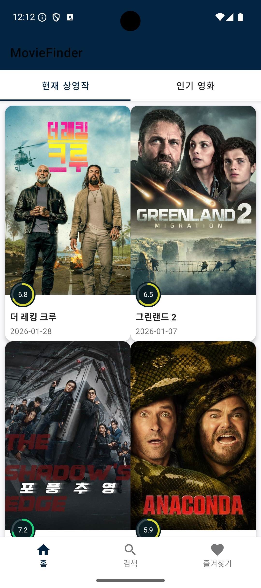
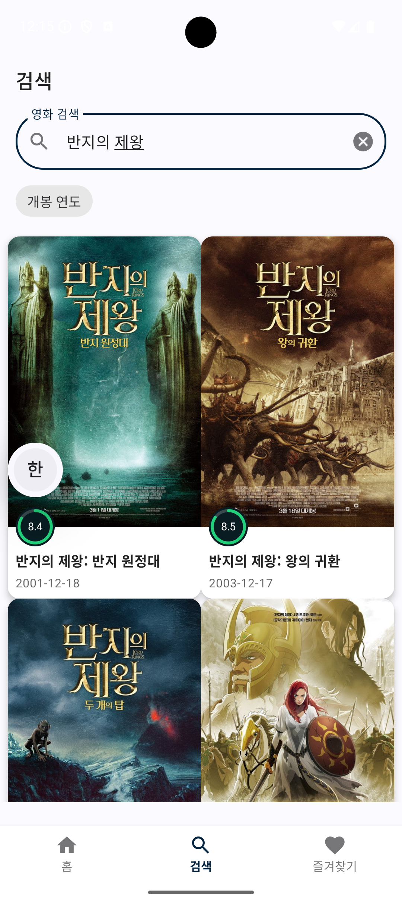
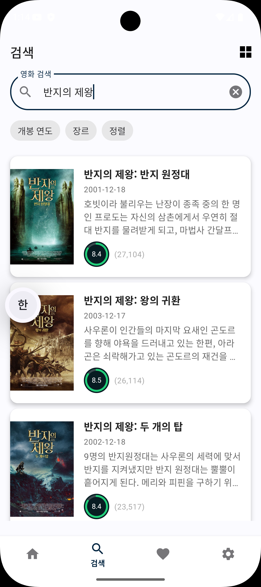
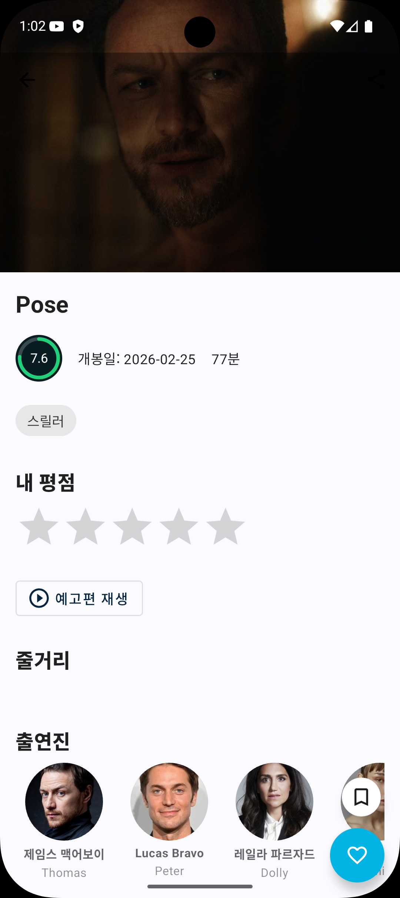
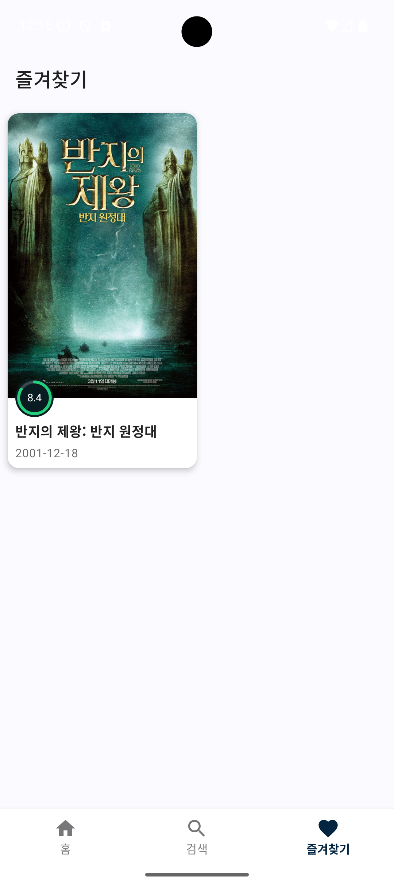
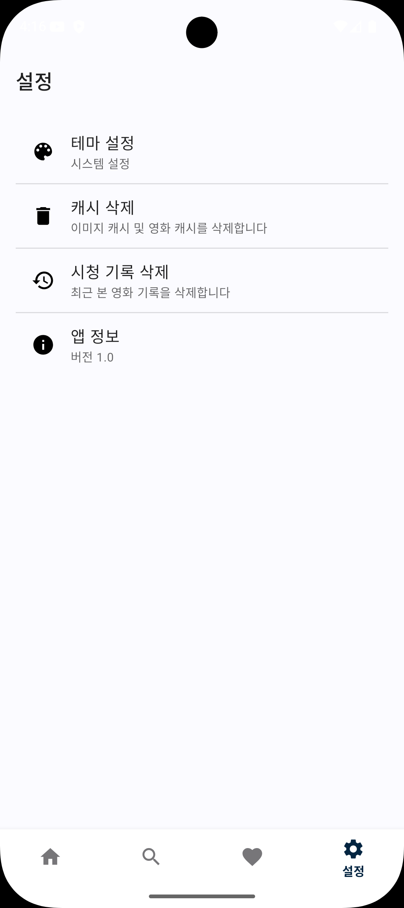

# MovieFinder

> TMDB API를 활용한 영화 검색 Android 앱


Clean Architecture + MVVM 패턴 기반으로, 오프라인 캐시, 다크 모드, 페이징, 딥링크 등 실무 수준의 기능을 구현했습니다.

---

## 🤖 AI 활용 하이라이트

이 프로젝트는 단순한 앱이 아니라, **AI 기반 개발 워크플로우**를 직접 실험한 결과물입니다.

| 실험 내용 | 도구 | Before | After |
|---|---|---|---|
| 시청 통계 기능 전체 설계 및 구현 | Claude Code | 기능 없음 | UseCase 49개, Repository 11개 인터페이스 (작성 시점 값 — 현재는 UseCase 78개, Repository 인터페이스 21개) |
| PR 코드 리뷰 자동화 | GitHub Actions + Claude API | 수동 리뷰 | PR 생성 시 자동 리뷰 코멘트 게시 |
| 테스트 커버리지 개선 | Claude Code + JaCoCo | 미측정 (0%) | Line **78%** / Branch **72%** 달성 |
| 유닛 테스트 작성 | Claude Code | 0개 | **987개** 자동 작성 |
| 라이브러리 보안 취약점 분석 | Exa MCP | 미점검 | 실시간 웹 검색으로 실제 버그 발견 |
| think / ultra think 프롬프트 비교 | Claude Code | 단일 분석 | 4에이전트 병렬, **30개+ 이슈** 자동 발견 |

📂 실험 전체 기록: [AI-dev-notes](https://github.com/ChooJeongHo/AI-dev-notes)
---

## Screenshots

| Home | Search (Grid) | Search (List) | Detail | Favorite | Settings |
|:----:|:-------------:|:-------------:|:------:|:--------:|:--------:|
|  |  |  |  |  |  |

---

## Tech Stack

| Category | Stack |
|----------|-------|
| Language | Kotlin 2.3.21 |
| Build | AGP 9.4.1, Gradle 9.8.1, KSP 2.3.12 |
| UI | XML Layouts + ViewBinding (대부분 화면), Jetpack Compose(검색 결과 화면 일부 + 온보딩 화면), Jetpack Glance(박스오피스 위젯), Material Components 1.14.0 |
| Architecture | Clean Architecture, MVVM |
| DI | Hilt 2.60.1 |
| Network | Retrofit 3.0.0, OkHttp 5.5.0, kotlinx.serialization 1.11.0 |
| Database | Room 2.8.5, Typed DataStore 1.2.1 |
| Async | Coroutines, Flow, StateFlow, Channel |
| Paging | Paging 3.5.2, RemoteMediator |
| Image | Coil 3.6.3 |
| Navigation | Navigation Component 2.10.2, Safe Args |
| Security | Certificate Pinning (OkHttp), EncryptedSharedPreferences |
| Background | WorkManager 2.12.0 |
| Test | JUnit 4, MockK 1.14.11, Turbine 1.2.1 (987개 유닛 + 34개 Espresso) |
| CI/CD | GitHub Actions (Build / Test / Coverage / Cert Pinning / Claude 자동 리뷰 / Auto-merge) |
| Static Analysis | Detekt 2.0.0-alpha.6 + KtLint |

---

## Architecture

```
API/DB  →  Repository  →  UseCase  →  ViewModel  →  Fragment (XML UI, 검색 결과는 Compose)
```

```
app/src/main/java/com/choo/moviefinder/
├── core/           # 공유 유틸리티 (ErrorMessageProvider, NetworkMonitor, 알림)
├── data/           # 데이터 레이어 (Room, Retrofit, PagingSource, RemoteMediator)
├── domain/         # 도메인 레이어 (Model, Repository 인터페이스, UseCase 78개)
├── presentation/   # 프레젠테이션 레이어 (Fragment, ViewModel, Adapter)
├── di/             # Hilt DI 모듈
├── MainActivity.kt
└── MovieFinderApp.kt
```

| 레이어 | 규칙 |
|--------|------|
| Domain | 순수 Kotlin, Android 프레임워크 의존성 없음 |
| Repository | ISP 원칙 기반 도메인별 분리 (21개 인터페이스) |
| Presentation | Domain UseCase에만 의존, Data 레이어 직접 참조 금지 |

---

## Features

| 화면 | 주요 기능 |
|------|-----------|
| 홈 | 현재 상영작 / 인기 영화 / 트렌딩 탭, Paging 3 무한 스크롤, 오프라인 캐시 (RemoteMediator), 최근 본 영화, KOFIC 일별·주간 박스오피스 TOP 10 (TMDB 매칭, KMRB 관람등급 배지) |
| 검색 | 실시간 검색 (debounce), 연도 / 장르 / 정렬 / KMRB 관람등급 필터, Discover 모드, 그리드 ↔ 리스트 전환, 배우 검색 |
| 영화 상세 | 출연진 / 추천 영화 / 리뷰 / 예고편 (YouTube 연결), 즐겨찾기 / 워치리스트, 내 평점, 메모, 스트리밍 정보, KMRB 국내 관람등급, Shared Element Transition |
| 배우 상세 | 프로필, 바이오그래피, 필모그래피 |
| 시리즈 | 영화 컬렉션 (시리즈) 조회 |
| 즐겨찾기 | 즐겨찾기 / 워치리스트 탭, 스와이프 삭제 + Undo, 정렬, 태그, 워치리스트 개봉일 알림 |
| 설정 | 테마 / 언어 전환, 시청 목표, 데이터 백업 (JSON), TMDB 계정 연결 |
| 통계 | 시청 편수, 평균 별점, 장르 파이차트, 월별 바차트, 평점 히스토그램, 캘린더 히트맵 |
| 온보딩 | 첫 실행 시 3페이지 온보딩 화면 |
| 알림 이력 | 예약된 개봉일 알림 목록 조회 및 취소 |

**기타**
- 홈 화면 위젯 4종: 인기 영화 Top 10(RemoteViewsService, 1시간 자동 갱신), 즐겨찾기, 시청 목표, 박스오피스(Jetpack Glance, 일별/주간 전환)
- App Shortcuts: 검색 / 즐겨찾기 정적 단축키 + 최근 시청 영화 동적 단축키
- 개봉일 알림 / 시청 목표 달성 알림 (WorkManager)
- 딥링크: `moviefinder://movie/{id}`, `moviefinder://person/{id}`, `moviefinder://stats`
- 한국어 + 영어 다국어 지원 (Per-App Language) — 영화 상세·목록의 TMDB 데이터도 앱 언어를 따릅니다 (검색 결과는 데이터는 한국어 기준이고 표시 제목만 앱 언어를 따름)
- Material You 동적 색상 (Android 12+, XML 화면과 Compose 화면 모두)
- Baseline Profiles
- Predictive Back Gesture (Fragment 전환 스크러빙 미리보기)

### 알려진 한계: 검색 화면 KMRB 관람등급 필터

KMRB에 일괄 조회 API가 없어 결과를 항목별로 조회해 걸러냅니다. 아래는 현재 상태입니다 (실기기 SM-S926N 검증).

**해결됨**
- 필터 적용 중 "검색 결과 없음"이 잘못 표시되던 문제: 마지막 페이지까지 확인한 뒤에만 "결과 없음"을 보여주고, 그 전에는 로딩 상태를 표시합니다.
- 결과를 2페이지 이상 스크롤한 뒤 등급 칩을 선택하면 이어 로드가 멈추던 문제: 등급이 바뀌면 재검색하도록 구조를 바꿨습니다.

**미해결**
- 대기 시간: 항목별 순차 조회라 콜드 캐시에서 한 페이지(20건)에 약 10초가 걸립니다. 조건에 맞는 항목이 드문 조합은 페이지를 계속 이어 불러와 1분 이상 걸립니다 (실측 86~138초). 조회한 등급은 Room에 캐시되어(등급 없음은 24시간) 같은 제목은 이후 빠릅니다.
- 연쇄 로드에 상한이 없습니다.
- KMRB 장애나 호출 한도 소진(HTTP 429) 중에 등급 칩을 고르면, 조회 실패가 "해당 등급 아님"으로 처리되어 전 페이지를 연쇄 조회하며 KMRB를 계속 호출합니다 (칩을 `전체`로 되돌리면 멈춥니다).
- 등급을 바꿀 때마다 TMDB 재검색과 목록 새로고침(로딩 표시)이 발생합니다.

### 알려진 한계: 홈 화면 목록 (1단계 수정)

가로 모드 점검(실기기 SM-S926N, 1440x3120)에서 홈의 메인 목록(`rv_movies`)이 시청기록이 있을 때 세로·가로 모두 높이 0px로 측정됐습니다. 스크롤 없는 고정 스택 안에서 박스오피스·시청기록 섹션이 화면을 다 차지했기 때문입니다. 두 섹션을 위로 밀어 접으면 목록이 나타나도록 고쳤습니다 (1단계).

**목록은 도달 가능해졌지만 첫 화면에서는 여전히 안 보이고, 밀어야 한다는 단서가 없다. 첫 화면 노출은 별도 제품 결정이 필요하다.**

**해결됨**
- 섹션을 접으면 목록이 보입니다: 접은 뒤 목록 가시 높이 세로 2265px, 가로 775px (실기기). "맨 위로" 버튼(FAB)과 상단 탭·하단 내비 재선택은 섹션도 함께 펼칩니다.

**미해결 / 알아둘 점**
- 첫 화면의 목록은 여전히 0px입니다 (시청기록이 있을 때). 시청기록이 없을 때 세로 약 923px, 가로 0px은 같은 해상도의 에뮬레이터(AVD) 보조 측정이며 실기기 측정이 아닙니다.
- 당겨서 새로고침이 바뀌었습니다: 섹션이 접힌 상태에서는 첫 당김이 섹션을 펼치고(스피너 없음), 새로고침은 그다음 당김부터 동작합니다.
- **R1 재정의**: 수정 전 값을 "1px도 바뀌면 안 된다"로 두었으나, 시청기록 섹션(937→1024px)과 가로 박스오피스(775→1328px)가 바뀌었습니다. 수정 전 값은 마지막 `wrap_content` 자식이 남은 높이에 맞춰 측정되어 **잘린 값**이었고(제목이 포스터에 겹쳐 보임), 접히는 앱바 안에서는 원래 높이로 측정되어 풀린 것입니다. 1px도 바뀌지 않은 것은 툴바·탭 491px와 세로 박스오피스 1328px입니다.
- `HomeFragmentTest`(androidTest)는 `rv_movies`가 화면에 보이는지(`isDisplayed`)를 검사하므로 이 기기에서는 이미 실패할 가능성이 큽니다. 이번 작업에서는 수정도 실행도 하지 않았고, CI는 androidTest를 실행하지 않습니다.
- 측정하지 못한 것: 다크 모드, TalkBack, 다른 화면 크기·태블릿, 프로세스 종료 후 접힘 상태 복원.

### 알려진 한계: 상세 화면 메모 입력란과 키보드 (수정)

실기기(SM-S926N, 1440x3120, 3버튼)에서 상세 화면의 메모 입력란을 탭해 키보드를 올리면 입력란이 키보드 뒤로 가려졌습니다 (25회 이상, 가시 높이 0px). 메모가 없으면 입력란 아래 콘텐츠(1068px)가 키보드 높이(1326px)보다 짧아 스크롤로도 닿지 않았습니다. 원인은 설정 하나가 아니라 구조입니다. `DetailFragment`의 인셋 리스너가 내비게이션 바만 패딩에 반영하고 키보드(IME)를 무시했고, `enableEdgeToEdge()`라 창이 줄어들지도 않았습니다. `windowSoftInputMode`는 이미 `adjust=resize`라 원인이 아닙니다. 인셋 리스너가 키보드 높이를 패딩에 반영하고, 키보드가 올라와 입력란이 포커스를 가지면 입력란이 키보드 위에 보이도록 스크롤하게 고쳤습니다 (`DetailFragment.kt` 1개, +22/−2).

**해결됨**
- 키보드를 올리면 입력란이 키보드 위에 전부 보입니다: 영화 4종 × 위치 3곳 × 3회 36/36, 입력 1→4줄(217/291/365/439px) 12회 × 4줄 48/48 (가시 높이 = 입력란 높이). 영화 4종에는 포스터·백드롭이 없는 영화(입력란 아래 콘텐츠 736px)가 포함됩니다.
- 키보드가 없을 때 레이아웃은 수정 전과 같습니다: 상세 콜드 레이아웃과 홈·검색 세로/가로의 뷰 계층(id 기준)이 수정 전 APK와 diff 0입니다.
- 뒤로 키로 키보드만 닫고 재탭, 저장 직후 재탭, 빠른 나가기, 홈→상세→뒤로, IME 전송 키 저장(가로)은 이상이 없었고 크래시 0건입니다.

**R6 재정의**
- R6의 "닫힘은 수정 전과 같을 것"은 포커스 해제와 키보드 닫힘 동작 자체를 뜻하며, 닫힌 뒤의 스크롤 위치는 대상이 아닙니다. 수정 전 0px은 입력란이 키보드에 가려져 스크롤이 일어날 수 없던 상태의 값이라 기준이 될 수 없고, 닫힐 때 스크롤 범위가 줄어 clamp되는 것은 IME 패딩 방식의 결과입니다.
- 키보드를 닫으면 페이지가 스크롤 끝으로 이동합니다: 입력란 위치 A(처음 보이는 위치) −147~−161px, B(스크롤 끝) 0px, C(화면 아래쪽) −875px. 닫히는 순간 프레임(A·C)에서 깜빡임·빈 화면·목록 재배치는 보이지 않았지만, 녹화에 0.5초 안팎의 프레임 공백이 있어 그보다 짧은 중간 상태는 확인하지 못했습니다.

**미해결 / 알아둘 점**
- 키보드를 연 채 세로→가로→세로로 회전하면 입력란이 평소보다 657px 더 위로 스크롤됩니다 (입력란은 전부 보임). 가로→세로 방향은 정상입니다.
- 프로세스 복원 직후 키보드가 복원되면 입력란이 키보드 뒤에 남습니다 (스크롤하면 닿음). 원인은 포커스 이벤트가 없어서로 추정할 뿐 확인하지 못했습니다.
- 메모 수정 다이얼로그의 IME 상호작용은 확인하지 못했습니다 (다이얼로그가 떠 있는 동안 키보드가 뜨지 않았고, 열고 닫은 전후 스크롤 위치는 같았습니다).
- 저장 직후 메모 목록이 그려지지 않는 별개 결함은 125일차 작업 시점에는 남아 있었고(저장 직후 표시 0/6, 새로 열어도 간헐적으로 안 그려짐, 당시 `setHasFixedSize(true)` + `wrap_content` 가설은 개행으로 재측정을 일으키는 시험에서 지지되지 않음), 126일차에 수정했습니다 — 아래 절.
- 상세 외 화면(검색 등)의 키보드 처리는 측정하지 않았습니다. API 24~29와 제스처 내비는 검증하지 못했습니다.

### 알려진 한계: 상세 화면 메모 목록 (수정)

실기기(SM-S926N, 1440x3120, 3버튼)에서 메모를 저장해도 상세 화면의 메모 목록(`rv_memos`)이 그려지지 않았습니다. 수정 전 저장 직후 표시는 0/40이었습니다(메모가 0개면 목록 높이가 0px로 남았고, 2개가 있으면 새 메모가 위쪽 밖에 놓였습니다). 화면을 새로 열면 18/20으로 보였습니다. 원인은 `setHasFixedSize(true)`와 `wrap_content`의 조합입니다. 어댑터 내용이 바뀌어도 레이아웃 재요청이 생략돼 높이가 굳었습니다. `DetailFragment.kt`에서 그 호출 한 줄을 지웠습니다 (+1/−1, 이유를 적은 주석 포함).

**해결됨**
- 저장 직후 목록이 보입니다: 40/40, 화면을 새로 열면 20/20. 같은 코드에서 그 한 줄만 바꾼 전/후 비교라 원인을 확정했습니다. 다만 수정 전/후 APK를 따로 빌드해 비교했고, 두 바이너리가 그 한 줄 외에 같다는 것까지는 검증하지 않았습니다.
- 125일차 결과는 그대로입니다: 키보드를 올렸을 때 입력란 가시 217/217px, 입력 1~4줄 48/48, 콜드 레이아웃 diff 0.

**미해결 / 알아둘 점**
- `rvReviews`(`DetailFragment.kt`)와 가로 목록(`setupHorizontal`)에도 같은 `setHasFixedSize(true)`가 남아 있지만, 같은 문제가 있는지는 점검하지 않았습니다.
- 스크롤 끝에서 높은 목록의 맨 위가 화면 밖에 있는 것은 일반 스크롤 동작으로 판단했습니다. 저장 후 새 메모를 맨 위에 보이게 하는 별도 방안은 필요하다는 의견이 있을 때 검토합니다.
- 삭제 직후에는 uiautomator 덤프가 idle 상태를 얻지 못해 실패했고(원인 미확인), 키보드를 연 채 삭제한 경우는 스크린샷 픽셀 측정 4/4로만 확인했습니다.

---

## Testing

유닛 테스트 **987개** + Espresso UI 테스트 **34개** | Line Coverage **78%** | Branch Coverage **72%**

> 커버리지는 2026-10-16 `jacocoTestReport` 실측(유닛 테스트 기준): Line 78.48% / Branch 72.15% / Instruction 73.91%. Espresso 34개는 `@Test` 개수이며 CI는 androidTest를 실행하지 않습니다.

```bash
# 유닛 테스트
./gradlew testDebugUnitTest

# UI 테스트 (에뮬레이터/실기기 필요)
./gradlew connectedDebugAndroidTest

# 커버리지 리포트 (최소 50% 기준)
./gradlew jacocoTestReport
```

---

## CI/CD

| 워크플로우 | 트리거 | 내용 |
|-----------|--------|------|
| `android-ci.yml` | push / PR → main | Detekt → Lint → Build → Test → JaCoCo |
| `cert-pin-check.yml` | 매주 월요일 | 인증서 핀 검증, 불일치 시 Issue 생성 |
| `pr-coverage.yml` | PR → main | 커버리지 리포트 PR 코멘트 자동 게시 |
| `claude-code-review.yml` / `claude-pr-review.yml` | PR open/synchronize | Claude 기반 자동 코드 리뷰 코멘트 |
| `claude.yml` | 이슈/PR 코멘트 | `@claude` 멘션 시 Claude Code 응답 |
| `auto-merge.yml` | PR | 조건 충족 시 자동 병합 |
| `release.yml` | `v*.*.*` 태그 push | 릴리즈 자동화 |
| Pre-commit Hook | git commit | Detekt + 컴파일 체크 |
| Pre-push Hook | git push | 유닛 테스트 전체 + `:app:lintDebug` |

---

## Setup

### 1. API Key 발급

- [TMDB](https://www.themoviedb.org/settings/api) — 필수, 앱 전체 기능에 필요
- [KOFIC 영화진흥위원회 Open API](https://www.kobis.or.kr/kobisopenapi/) — 선택, 홈 화면 박스오피스 기능에 필요
- [KMRB 영상물등급위원회 Open API](https://www.data.go.kr/data/15057639/openapi.do) — 선택, 국내 관람등급 표시/필터 기능에 필요

### 2. local.properties 설정

```properties
TMDB_API_KEY=your_tmdb_api_key
KOFIC_API_KEY=your_kofic_api_key       # 선택 - 박스오피스 기능
KOFB_API_KEY=your_kmrb_api_key         # 선택 - KMRB 관람등급 기능 (키 이름은 KOFB_API_KEY)
```

> `tools/codebase-rag`(개발용 RAG 검색 도구)는 `ANTHROPIC_API_KEY`/`VOYAGE_API_KEY`를 별도로 사용하지만, 앱 빌드에는 영향 없음.

### 3. 빌드

```bash
./gradlew assembleDebug
```

### 4. 딥링크 테스트 (adb)

```bash
adb shell am start -a android.intent.action.VIEW -d "moviefinder://movie/550"
adb shell am start -a android.intent.action.VIEW -d "moviefinder://person/6193"
adb shell am start -a android.intent.action.VIEW -d "moviefinder://stats"
```

> CI/CD 사용 시 GitHub Secrets에 `TMDB_API_KEY` 등록 필요

---

## Requirements

- Android Studio (AGP 9.4.1)
- JDK 21+
- compileSdk 37 / minSdk 24 / targetSdk 36

## License

MIT License
